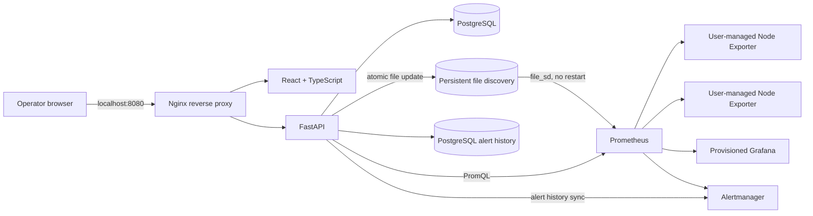
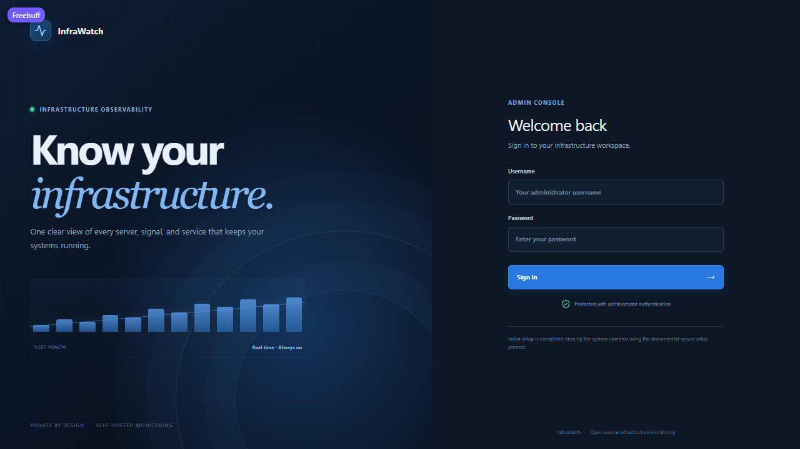

# InfraWatch

InfraWatch is a self-hosted infrastructure monitoring console for Linux and Windows hosts. Register hosts that run Node Exporter or windows_exporter, collect their measurements with Prometheus, inspect fleet health in a React UI, and manage alert routing through Alertmanager and Grafana.

> **Release status:** v1.0.0 candidate, not yet declared production ready. The frontend, backend, Compose deployment, migrations, dynamic discovery, container/endpoint/process/Windows monitoring, centralized logs, three-target Linux integration smoke, and browser workflow are implemented. This repository's CI and hardening gates are described below. Review the [roadmap](docs/roadmap.md) for remaining evidence gaps before any production release.

## Features

| Area | What you get |
| --- | --- |
| Fleet inventory | Searchable server registry with environments, tags, health status, and per-server metric history. |
| Secure access | Argon2id password hashing, short-lived JWTs, server-side logout revocation, and a one-time first-run administrator setup. |
| Linux metrics | CPU, memory, filesystem, disk I/O, network, load, uptime, and exporter availability from Node Exporter. |
| Windows metrics | CPU per core, memory, volumes, network, services, and uptime from windows_exporter (automatic platform detection). |
| Docker containers | Per-container CPU, memory, filesystem, network, limits, restarts, and image inventory from cAdvisor. |
| Websites and endpoints | HTTP/HTTPS, TCP, DNS, and ICMP probes with latency, status codes, and TLS certificate expiry from Blackbox Exporter. |
| Processes | Named process-group CPU, memory, restart, and disappearance detection from process-exporter. |
| Centralized logs | Loki + Alloy collecting Docker, Nginx, host, and application logs, filterable by host, service, and severity. |
| Dashboards | Ten provisioned Grafana dashboards, including system overviews, containers, endpoints, logs, SSL, and application metrics. |
| Alerting | 30 Prometheus alert rules, Alertmanager grouping/routing, and firing/resolved history persisted in PostgreSQL. |
| Application metrics | FastAPI `/metrics` instrumentation, ten recording rules, and Nginx request/connection metrics from nginx-prometheus-exporter. |
| Safe operations | SSRF-checked registration, CIDR/port allowlists, atomic file-based discovery without Prometheus restarts, no SSH or remote command execution. |

**New here?** Start with the [quick start](#quick-start), then read the [beginner guide](docs/beginners-guide.md) for adding your first server.

## Architecture



The API commits registry updates, audit entries, and an outbox event in PostgreSQL, then publishes a synchronized snapshot using a same-directory atomic replacement. A periodic reconciler repairs interrupted publication. Prometheus discovers targets from the mounted directory. See [architecture and trust boundaries](docs/architecture.md).

## Stack

| Layer | Technology |
| --- | --- |
| UI | React 19, TypeScript, Vite, Tailwind CSS, Recharts, Lucide |
| API | Python 3.11, FastAPI, SQLAlchemy 2, Pydantic, Alembic |
| Registry | PostgreSQL 17 |
| Metrics and alerts | Prometheus 3, Node Exporter, windows_exporter, cAdvisor, Blackbox Exporter, process-exporter, nginx-prometheus-exporter, Grafana 12, Alertmanager 0.28 |
| Logs | Grafana Loki 3, Grafana Alloy |
| Delivery | Docker Compose, non-root Nginx, GitHub Actions, Playwright, Trivy |

Versions are pinned in frontend lockfiles, backend requirements, Dockerfiles, and Compose. The CI workflow validates backend tests, UI workflows, image builds, and vulnerability scans.

## Requirements

- Linux host (recommended) with Docker Engine and Docker Compose v2.20 or newer (the root Compose file uses `include`).
- 2 CPU cores and 4 GB RAM minimum for a small development fleet; provision additional disk for Prometheus retention and backups.
- TCP/8080 to access InfraWatch. TCP/9100, 9182 and 9256 from the monitoring host to each exporter host; TCP/8080 to cAdvisor hosts.
- Node Exporter, cAdvisor, process-exporter or windows_exporter already installed on each monitored host. InfraWatch does not deploy them.
- For public endpoint probes, outbound Internet access (DNS and TCP/443) from the monitoring containers.

Windows and macOS can run InfraWatch with Docker Desktop and Compose v2.20 or newer, but exporter reachability depends on Docker Desktop networking and routing.

## Install and start

### Quick start

**You need:** Docker Engine 24+ with Compose v2.20+ (Docker Desktop on Windows/macOS), 2 CPU cores,
4 GB RAM, and ports 8080, 3000, 8000, and 9093 free (the last three bind to localhost only).

**1. Get the code**

```sh
git clone https://github.com/dhruvs-bankai/Infra-Watch.git
cd Infra-Watch
```

No Git? Use **Code → Download ZIP**, extract the archive, and open a terminal in that folder.

**2. Create your secrets**

```sh
# Linux / macOS
sh ./scripts/prepare-env.sh

# Windows PowerShell
powershell -ExecutionPolicy Bypass -File .\scripts\prepare-env.ps1
```

This writes a private `.env` with four random secrets. The file is ignored by Git — never commit or
share it.

**3. Start everything**

```sh
docker compose up -d --build
docker compose ps
```

The first build takes a few minutes. All services should become `healthy`; the one-time
`discovery-init` service exits successfully by design.

**4. Open the app**

Browse to **http://localhost:8080**. On first visit, copy `INITIAL_ADMIN_SETUP_TOKEN` from `.env` and
create your administrator account.

- Grafana: **http://localhost:8080/grafana/** — credentials are `GRAFANA_ADMIN_USER` and
  `GRAFANA_ADMIN_PASSWORD` from `.env`.
- Alertmanager: **http://localhost:8080/alertmanager/**.

Stop with `docker compose down`. Add `-v` only if you also want to delete all saved data.

Next: [add your first server](#add-a-server) or read the [beginner guide](docs/beginners-guide.md).

### Initial administrator setup

There are no default credentials. The first visit shows a one-time administrator setup form. Copy `INITIAL_ADMIN_SETUP_TOKEN` from the private `.env` file, choose a username and strong password, and create the administrator. This setup is disabled after the first account is created. The app stores its JWT in tab-scoped session storage and revokes it server-side on sign out.

## Add a server

1. Install Node Exporter on the Linux host using the [official release downloads](https://prometheus.io/download/) and the in-app installation guide.
2. Restrict inbound TCP/9100 on the host firewall to the InfraWatch monitoring host or subnet. Do not publish Node Exporter to the public Internet.
3. From InfraWatch, open **Server inventory → Register server**. Provide a display name, private IP or DNS hostname, exporter port, environment, description, and tags.
4. Registration fails with an actionable message if the target is unreachable, the endpoint does not expose Node Exporter metrics, or the target violates the configured network policy.
5. After a successful registration, Prometheus discovers the file change and starts scraping without a restart. The dashboard shows **No data** until the first scrape arrives.

## Metrics, Grafana, and alerts

The Metrics Explorer and server details query the Prometheus HTTP API over the private Compose network. Historical windows are bounded to seven days. CPU idle/system/user, memory and filesystem capacity, disk I/O, network bytes/packets/errors, system load, uptime, and exporter availability are available. The dashboard distinguishes a measured zero from a missing series.

- Open Grafana at **http://localhost:8080/grafana/**. The `Prometheus` data source and `InfraWatch Infrastructure Overview` dashboard are provisioned automatically. Grafana credentials are `GRAFANA_ADMIN_USER` and `GRAFANA_ADMIN_PASSWORD` from `.env`.
- Open Alertmanager at **http://localhost:8080/alertmanager/**. Alert rules cover exporter availability, CPU over 85%, memory over 90%, and filesystem usage over 90% (with a low-free-space critical condition).
- The InfraWatch alerts page shows current events and resolved events persisted by a 15-second Alertmanager poll. If Alertmanager is unavailable, the last saved history remains available; resolution timestamps may be delayed.
- Default Alertmanager routing is local-only. Operators must deliberately configure an email, webhook, or chat receiver and its credentials; InfraWatch does not assume SMTP settings.
- Alert thresholds are currently defined in versioned Prometheus rule files. Database-backed threshold editing is not included in this release candidate.

## Extended monitoring integrations

Open **Monitoring integrations** in the sidebar to see everything supported, attach an exporter to a registered host, re-test reachability, enable or disable it, and read the official installation steps. Open **Endpoints** to monitor websites, APIs, TCP ports, DNS names and hosts with Blackbox Exporter.

| Integration | What it adds | Guide |
| --- | --- | --- |
| cAdvisor | Per-container CPU, memory, filesystem, network, disk I/O, limits, restarts | [Container monitoring](docs/integrations.md#3-docker-containers-with-cadvisor) |
| Blackbox Exporter | HTTP/HTTPS, TCP, DNS, ICMP, latency and TLS certificate expiry | [Endpoint monitoring](docs/integrations.md#4-websites-apis-tcp-ports-dns-and-ping-with-blackbox-exporter) |
| process-exporter | CPU, memory and availability for named process groups | [Process monitoring](docs/integrations.md#5-processes-with-process-exporter) |
| windows_exporter | Windows CPU, memory, disks, network, services and uptime | [Windows monitoring](docs/integrations.md#6-windows-servers-with-windows_exporter) |
| Loki + Alloy | Centralized Docker, Nginx, system and application logs | [Centralized logging](docs/integrations.md#7-centralized-logs-with-loki-and-grafana-alloy) |
| Application metrics | API `/metrics` instrumentation, recording rules, Nginx exporter | [Requirement coverage](docs/requirements-map.md) |

No integration requires SSH or remote command execution. All exporter ports remain private; use host firewalls to allow only the InfraWatch monitoring host.

Grafana receives ten provisioned dashboards: Infrastructure Overview, Linux Server Details, Windows Server Details, Docker Container Monitoring, Network & Endpoint Monitoring, Process Monitoring, Centralized Logs, SSL Certificate Monitoring, Integration Health and Application Metrics. Logs are available in **Grafana → Explore → Loki** and the Centralized Logs dashboard.

## Development and verification

Backend tests use a local SQLite test database; the live integration smoke uses the full Compose/PostgreSQL stack and three temporary Linux Node Exporter containers.

```sh
python -m venv backend/.venv
backend/.venv/bin/pip install -r backend/requirements-dev.txt
PYTHONPATH=backend backend/.venv/bin/python -m pytest -q backend/tests
cd frontend
npm ci
npm run build
npm run test:e2e
cd ..
python scripts/verify_backend_runtime.py
python scripts/verify_integrations_runtime.py
```

On Windows, use `backend\.venv\Scripts\python.exe` and `backend\.venv\Scripts\pip.exe` in PowerShell. Playwright requires its Chromium browser (`npx playwright install chromium`). The browser workflow test uses deterministic **test-only** API fixtures; it verifies interactions, while the Compose runtime smoke checks real API, PostgreSQL, Prometheus scraping, metrics, Grafana provisioning, restarts, and target discovery.

## Screenshots



This is the deployed local Compose login page. The dashboard and charts require a configured administrator and registered exporter targets.

## Security and operations

- The API validates hostname/IP syntax, rejects URL schemes, resolves and pins an approved numeric target, disables proxy use and redirects, and limits connectivity checks to configured ports/CIDRs. Add a network egress firewall as a second boundary.
- Compose separates application/monitoring services from PostgreSQL; Nginx and the static frontend run unprivileged with dropped capabilities and read-only filesystems. Loopback ports for direct API/Grafana/Alertmanager administration are optional host-local access points.
- Set a strong random JWT key and setup token, keep credentials outside Git, disable inbound exporter access from untrusted networks, and provide TLS before remote browser access.
- PostgreSQL, Prometheus TSDB, Grafana, Alertmanager, and discovery files use named persistent volumes. Configure off-host backups and test restore procedures before production.
- This is a single-administrator control plane. Authentication rate limiting, external TLS termination, backup/restore automation, and a production restore drill are not yet demonstrated; see [security review](docs/security.md) and [release roadmap](docs/roadmap.md).

## Documentation

- [Architecture](docs/architecture.md)
- [Monitoring integrations guide](docs/integrations.md)
- [Beginner setup guide](docs/beginners-guide.md)
- [Installation and configuration](docs/configuration.md)
- [Security review](docs/security.md)
- [Implementation roadmap and release gates](docs/roadmap.md)
- [Troubleshooting](docs/troubleshooting.md)

## License

MIT. See [LICENSE](LICENSE).
