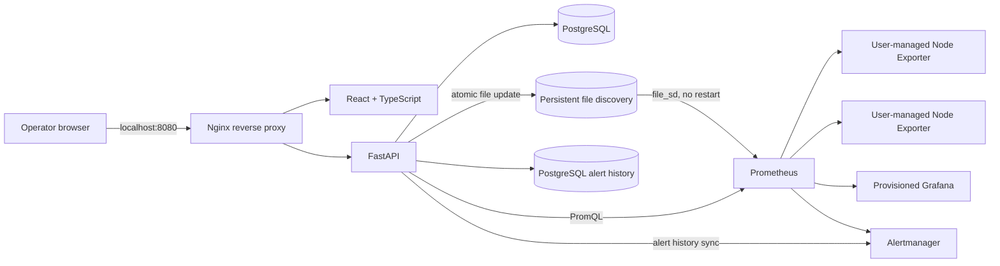

# InfraWatch

InfraWatch is a self-hosted infrastructure monitoring console for Linux. Register hosts that run Node Exporter, collect their measurements with Prometheus, inspect fleet health in a React UI, and manage alert routing through Alertmanager and Grafana.

> **Release status:** v1.0.0 candidate, not yet declared production ready. The frontend, backend, Compose deployment, migrations, dynamic discovery, three-target Linux integration smoke, and browser workflow are implemented. This repository's CI and hardening gates are described below. Review the [roadmap](docs/roadmap.md) for remaining evidence gaps before any production release.

## What it does

- Administrator login with Argon2id password hashing, short-lived JWTs, and server-side logout revocation.
- Responsive dashboard, server inventory with search and environment/status filters, server details, and metric history charts.
- Server creation validates Node Exporter connectivity and rejects targets outside configured CIDR and port allowlists.
- PostgreSQL is the registry source of truth. An atomic, reconciled Prometheus file-discovery snapshot updates without restarting Prometheus.
- CPU, memory, filesystem capacity, disk I/O, network throughput/packets/errors, load, uptime, and exporter availability are queried from Prometheus. No samples are displayed as unavailable; production views do not seed demo metrics.
- Grafana is provisioned with its Prometheus data source and starter dashboard. Alertmanager handles grouping/routing; firing and resolved alert events are copied into PostgreSQL for the UI.
- A step-by-step Node Exporter guide provides copyable Linux/systemd commands. InfraWatch never installs agents, connects over SSH, or runs remote commands.

## Architecture



The API commits registry updates, audit entries, and an outbox event in PostgreSQL, then publishes a synchronized snapshot using a same-directory atomic replacement. A periodic reconciler repairs interrupted publication. Prometheus discovers targets from the mounted directory. See [architecture and trust boundaries](docs/architecture.md).

## Stack

| Layer | Technology |
| --- | --- |
| UI | React 19, TypeScript, Vite, Tailwind CSS, Recharts, Lucide |
| API | Python 3.11, FastAPI, SQLAlchemy 2, Pydantic, Alembic |
| Registry | PostgreSQL 17 |
| Metrics and alerts | Prometheus 3, Node Exporter, Grafana 12, Alertmanager 0.28 |
| Delivery | Docker Compose, non-root Nginx, GitHub Actions, Playwright, Trivy |

Versions are pinned in frontend lockfiles, backend requirements, Dockerfiles, and Compose. The CI workflow validates backend tests, UI workflows, image builds, and vulnerability scans.

## Requirements

- Linux host (recommended) with Docker Engine and Docker Compose v2.20 or newer (the root Compose file uses `include`).
- 2 CPU cores and 4 GB RAM minimum for a small development fleet; provision additional disk for Prometheus retention and backups.
- TCP/8080 to access InfraWatch. TCP/9100 from the monitoring host to each Node Exporter host.
- Node Exporter already installed on each Linux server. InfraWatch does not deploy it.

Windows and macOS can run InfraWatch with Docker Desktop and Compose v2.20 or newer, but exporter reachability depends on Docker Desktop networking and routing.

## Install and start

### Beginner quick start

```sh
Download the repository ZIP from GitHub using **Code → Download ZIP**, extract it, and open a terminal in the extracted `infrawatch` folder. Install Docker Desktop (Windows/macOS) or Docker Engine plus Compose v2 (Linux).

Create four strong, private random secrets:

```sh
# Linux/macOS
sh ./scripts/prepare-env.sh

# Windows PowerShell (run this instead on Windows)
powershell -ExecutionPolicy Bypass -File .\scripts\prepare-env.ps1
```

The local `.env` holds private generated secrets and is ignored by Git; never share it. Start the whole application with one Compose command from the repository root:

```sh
docker compose up -d --build
docker compose ps
```

Wait until services are healthy (the one-time `discovery-init` service exits successfully), then open **http://localhost:8080**. The [plain-language beginner guide](docs/beginners-guide.md) explains each step and how to add your first server.

### Initial administrator setup

There are no default credentials. The first visit shows a one-time administrator setup form. Copy `INITIAL_ADMIN_SETUP_TOKEN` from the private `.env` file, choose a username and strong password, and create the administrator. This setup is disabled after the first account is created. The app stores its JWT in tab-scoped session storage and revokes it server-side on sign out.

## Add a server

1. Install Node Exporter on the Linux host using the [official release downloads](https://prometheus.io/download/) and the in-app installation guide.
2. Restrict inbound TCP/9100 on the host firewall to the InfraWatch monitoring host or subnet. Do not publish Node Exporter to the public Internet.
3. From InfraWatch, open **Server inventory → Register server**. Provide a display name, private IP or DNS hostname, exporter port, environment, description, and tags.
4. Registration fails with an actionable message if the target is unreachable, the endpoint does not expose Node Exporter metrics, or the target violates the configured network policy.
5. After a successful registration, Prometheus discovers the file change and starts scraping without a restart. The dashboard shows **No data** until the first scrape arrives.

## Metrics, Grafana, and alerts

The Metrics Explorer and server details query the Prometheus HTTP API over the private Compose network. Historical windows are bounded to seven days. CPU idle/system/user, memory and filesystem capacity, disk I/O, network bytes/packets/errors, system load, uptime, and exporter availability are available. The dashboard distinguishes a measured zero from a missing series.

- Open Grafana at **http://localhost:8080/grafana/**. The `Prometheus` data source and `InfraWatch Infrastructure Overview` dashboard are provisioned automatically. Grafana credentials are `GRAFANA_ADMIN_USER` and `GRAFANA_ADMIN_PASSWORD` from `.env`.
- Open Alertmanager at **http://localhost:8080/alertmanager/**. Alert rules cover exporter availability, CPU over 85%, memory over 90%, and filesystem usage over 90% (with a low-free-space critical condition).
- The InfraWatch alerts page shows current events and resolved events persisted by a 15-second Alertmanager poll. If Alertmanager is unavailable, the last saved history remains available; resolution timestamps may be delayed.
- Default Alertmanager routing is local-only. Operators must deliberately configure an email, webhook, or chat receiver and its credentials; InfraWatch does not assume SMTP settings.
- Alert thresholds are currently defined in versioned Prometheus rule files. Database-backed threshold editing is not included in this release candidate.

## Development and verification

Backend tests use a local SQLite test database; the live integration smoke uses the full Compose/PostgreSQL stack and three temporary Linux Node Exporter containers.

```sh
python -m venv backend/.venv
backend/.venv/bin/pip install -r backend/requirements-dev.txt
PYTHONPATH=backend backend/.venv/bin/python -m pytest -q backend/tests
cd frontend
npm ci
npm run build
npm run test:e2e
cd ..
python scripts/verify_backend_runtime.py
```

On Windows, use `backend\.venv\Scripts\python.exe` and `backend\.venv\Scripts\pip.exe` in PowerShell. Playwright requires its Chromium browser (`npx playwright install chromium`). The browser workflow test uses deterministic **test-only** API fixtures; it verifies interactions, while the Compose runtime smoke checks real API, PostgreSQL, Prometheus scraping, metrics, Grafana provisioning, restarts, and target discovery.

## Screenshots


This is the deployed local Compose login page. The dashboard and charts require a configured administrator and registered exporter targets.

## Security and operations

- The API validates hostname/IP syntax, rejects URL schemes, resolves and pins an approved numeric target, disables proxy use and redirects, and limits connectivity checks to configured ports/CIDRs. Add a network egress firewall as a second boundary.
- Compose separates application/monitoring services from PostgreSQL; Nginx and the static frontend run unprivileged with dropped capabilities and read-only filesystems. Loopback ports for direct API/Grafana/Alertmanager administration are optional host-local access points.
- Set a strong random JWT key and setup token, keep credentials outside Git, disable inbound exporter access from untrusted networks, and provide TLS before remote browser access.
- PostgreSQL, Prometheus TSDB, Grafana, Alertmanager, and discovery files use named persistent volumes. Configure off-host backups and test restore procedures before production.
- This is a single-administrator control plane. Authentication rate limiting, external TLS termination, backup/restore automation, and a production restore drill are not yet demonstrated; see [security review](docs/security.md) and [release roadmap](docs/roadmap.md).

## Documentation

- [Architecture](docs/architecture.md)
- [Beginner setup guide](docs/beginners-guide.md)
- [Installation and configuration](docs/configuration.md)
- [Security review](docs/security.md)
- [Implementation roadmap and release gates](docs/roadmap.md)
- [Troubleshooting](docs/troubleshooting.md)

## License

MIT. See [LICENSE](LICENSE).
