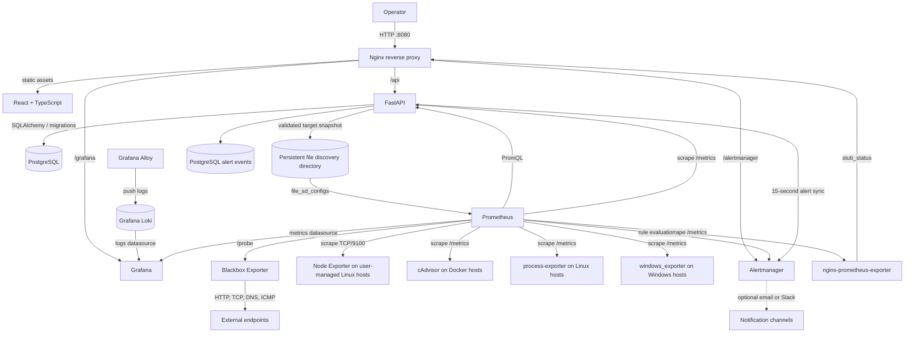
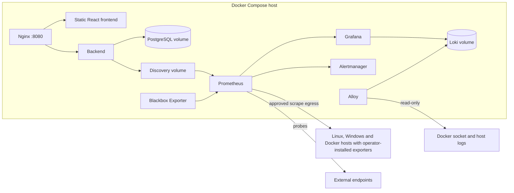

# InfraWatch architecture

## Scope

InfraWatch is intended to be a single-organization, self-hosted monitoring control plane. PostgreSQL stores application identity and inventory. Prometheus scrapes externally installed Node Exporters. The React application talks to FastAPI through Nginx. Grafana and Alertmanager consume the Prometheus data plane.

This document describes the implemented release-candidate design. Compose provisions the monitoring stack and reverse proxy. FastAPI, PostgreSQL, migrations, authentication, registry, audit log, SSRF-aware connectivity checks, multi-job file discovery, PromQL APIs, persisted alert transitions, integration management and endpoint monitoring are implemented. Grafana Loki and Grafana Alloy provide centralized logs. The React client and Nginx use the same-origin entry point at `http://localhost:8080`.

## Context and components

Prometheus also evaluates ten recording rules that precompute host, Windows, probe, API and Nginx series,
so dashboards query stable aggregates instead of recomputing rates in every panel. The API's own
`/metrics` endpoint is scraped as job `infrawatch`, and `nginx-prometheus-exporter` exposes Nginx request
and connection counters as job `nginx`.

## Registration and discovery flow

1. An authenticated operator submits a host, port, display name, environment, description, and tags.
2. The API validates syntax and applies an explicit egress policy before attempting an exporter connectivity check. It must not follow redirects or accept arbitrary URL schemes.
3. The API verifies the exporter endpoint and expected metrics response. Unreachable or invalid targets are rejected with an actionable error and are never represented as online.
4. A successful registration and audit event are committed to PostgreSQL.
5. A serialized discovery publisher builds the full target snapshot, validates its shape and destination, writes a temporary file in the discovery directory, flushes it, and atomically replaces the active file.
6. Prometheus observes the file change through `file_sd_configs` and begins scraping without a process restart.
7. The dashboard derives live availability and measurements from Prometheus; registry status and scrape status remain distinct concepts.

Removal follows the same snapshot publication process. A durable outbox plus a periodic reconciler repairs any publication that fails after the database commit.

## Integration and endpoint discovery

The same publisher writes a separate file per scrape job, so adding one integration cannot corrupt or
replace another job's targets:

| File | Job | Producers |
| --- | --- | --- |
| `servers.json` | `node` | Linux servers (Node Exporter) |
| `cadvisor.json` | `cadvisor` | cAdvisor integrations |
| `process.json` | `process` | process-exporter integrations |
| `windows.json` | `windows` | windows_exporter integrations and Windows platform servers |
| `probes-http.json` | `blackbox-http` | HTTP and HTTPS endpoint monitors |
| `probes-tcp.json` | `blackbox-tcp` | TCP endpoint monitors |
| `probes-dns.json` | `blackbox-dns` | DNS endpoint monitors |
| `probes-icmp.json` | `blackbox-icmp` | ICMP endpoint monitors |

All eight files are rewritten atomically on every publication. Disabled integrations and endpoints are
omitted, so removing a target requires no Prometheus restart. Because each job has its own file, an
unavailable cAdvisor or Windows exporter never affects Linux Node Exporter scrapes.

Windows hosts are a distinct platform: registration validates windows_exporter and creates its
integration, and the host is excluded from the Linux `node` job. Integration endpoints are attached to
their server's validated address, so a host runs one family of exporters per job.

## Log pipeline

Grafana Alloy discovers Docker containers through the read-only Docker socket, tails host log files from a
read-only `/var/log` mount, extracts a severity label, and pushes streams to Loki with `host`, `service`,
`container` and `source` labels. Alloy sets `host` from `INFRAWATCH_HOST_LABEL`, which is how logs are
associated with server identity. Loki stores data on a persistent volume for seven days by default. Loki
is not published to the host and has no built-in authentication in this configuration; Grafana queries it
over the private network.

## Network and trust boundaries

- **Browser to Nginx:** the application entry point binds to `127.0.0.1:8080` by default. Nginx sets security headers and routes API, Grafana, and Alertmanager requests.
- **Host to API:** the optional direct API port binds only to `127.0.0.1`; browser application requests use the reverse proxy.
- **Nginx to API/frontend/monitoring UIs:** the private `web` Compose network; PostgreSQL is not attached to this network.
- **API to PostgreSQL:** private network; database credentials are environment-supplied.
- **Prometheus to Node Exporter:** outbound scrape access to operator-managed hosts on approved monitoring networks. Host/IP validation and network egress controls must both be applied.
- **API to target validation and Prometheus/Alertmanager APIs:** outbound service calls. Use fixed internal service names for monitoring APIs; validate registry targets under the same SSRF policy.
- **Grafana/Prometheus/Alertmanager:** internal ports by default. Any optional public exposure requires an explicit documented operator override and authentication/TLS plan.

An application-level IP check alone does not prevent DNS rebinding or routing to metadata services. Implementation must pin resolution for validation/connection or enforce equivalent network-level egress restrictions, reject loopback/link-local/multicast/unspecified and unapproved ranges, and revalidate on edits. Private address access must be an explicit configurable allowlist because private networks are normal monitoring targets.

## Data ownership

PostgreSQL is authoritative for users, servers, tags, platform, monitoring integrations, endpoint monitors, alert thresholds, settings, audit events, discovery outbox events, and alert event transitions. Prometheus owns time-series history. Grafana dashboards, datasources and the Loki configuration are provisioned from repository files. Alertmanager handles routing and current alert state; the API polls and stores firing/resolution transitions in PostgreSQL. Loki owns log storage.

All stored timestamps use UTC. Password hashes only are stored. Do not persist exporter credentials; Node Exporter is expected to be protected by network boundaries unless a later authenticated exporter design is added.

## Operational characteristics

- Prometheus and PostgreSQL use persistent volumes. The generated file discovery directory also uses persistent storage and is rebuildable from PostgreSQL.
- Discovery publication is synchronized and atomic. Prometheus watches the directory and does not need to restart on every server change.
- Health checks gate dependent services, but health status is not a substitute for backups or readiness handling.
- Database migrations run as a controlled deployment step before API readiness.
- Prometheus retention and disk sizing must be configurable; default retention must be resource-conscious.
- Backups must cover PostgreSQL and any operator-created configuration. Prometheus TSDB backup policy is separate.

## Authentication model

The first-run setup creates the initial administrator only when no user exists and requires a one-time setup secret. Passwords use Argon2id. JWT access tokens have bounded lifetimes and a per-user token version; logout increments that version and invalidates existing tokens. The API returns bearer tokens; the frontend stores them in tab-scoped session storage. Registry mutations require an authenticated administrator and write audit events.

## Key architectural decisions

| Decision | Rationale |
| --- | --- |
| Prometheus file service discovery | Add/remove targets dynamically without mutating the main scrape configuration or restarting Prometheus. |
| PostgreSQL as registry authority | Durable inventory and audit trail; discovery files can be regenerated. |
| User-managed Node Exporter | Avoid privileged remote installation and keep host access under the operator's control. |
| Nginx as the only default host entry point | Centralizes routing and HTTP headers while keeping service ports private. |
| Provisioned Grafana | Makes dashboards and datasource repeatable from the first deployment. |

## Mermaid deployment view

